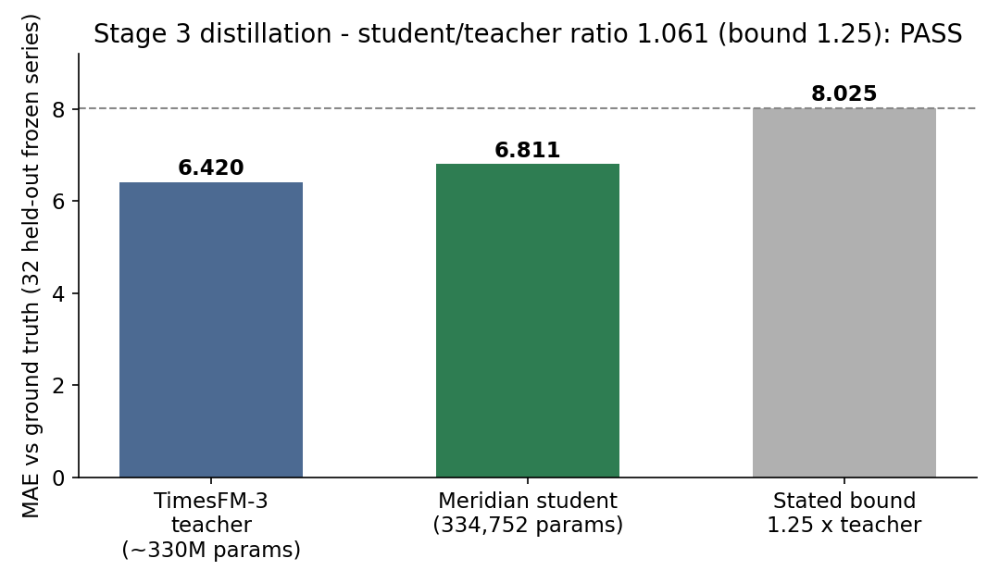
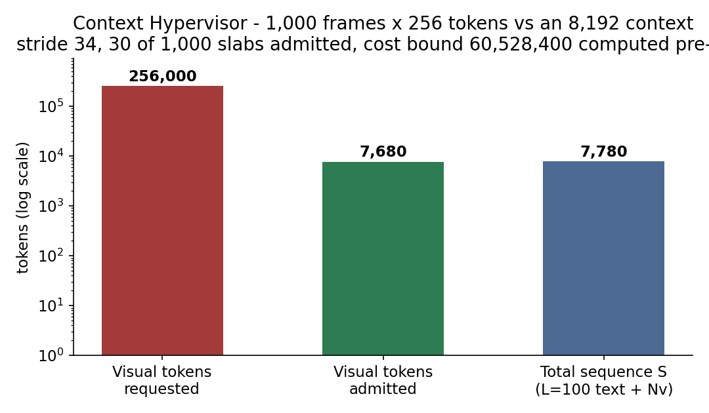
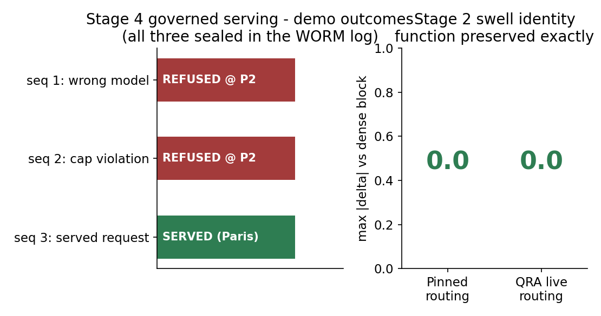

# Sovereign Composite

A composite model architecture assembled from verified parts: a zero-trust
GGUF parser reads a model's body from its bytes, a deterministic Context
Hypervisor governs what the model is allowed to perceive, a SWELLDRA swell
grows dense blocks into routed experts without changing the function, a
Meridian expert distills a time-series foundation model into a thousandth
of its size, and a governed serving court — capability policy, transition
audit, hash-chained ledger — decides what may be served at all.

Owners: Nova Parr, Ahmad Ali Parr, and Team HoloTwinKitty.
License: Sovereign Source License v1.0 (see `LICENSE`).

## Architecture

```
            ┌────────────────────────────────────────────────┐
            │              GOVERNED SERVING COURT            │
            │  P1 provenance · P2 capability · P3 context    │
            │  P4 output bounds · P5 WORM seal               │
            └───────────────┬────────────────────────────────┘
                            │ admitted sequence S only
            ┌───────────────▼────────────────────────────────┐
            │            CONTEXT HYPERVISOR (C11)            │
            │  topological admission · budget cap on N_v     │
            │  deterministic stride · decode pin (temp 0)    │
            └───────────────┬────────────────────────────────┘
                            │ verified topology
   ┌────────────────────────▼───────────────────────────┐
   │   COMPOSITE MODEL                                  │
   │   Gemma-class skeleton (GQA · SwiGLU · RMSNorm)    │
   │   SWELLDRA MoE swell (QRA router, H=0)             │
   │   Meridian time-series expert (distilled)          │
   │   MUM transition law · cross-encoder judge         │
   └────────────────────────▲───────────────────────────┘
                            │ parse before trust
            ┌───────────────┴────────────────────────────────┐
            │        SOVEREIGN-GEMINI-GGUF PARSER            │
            │  tensor inventory · Graph IR · zero-sorry      │
            │  validation · steering provenance per source   │
            └────────────────────────────────────────────────┘
```

## The demo — governed serving

`stage4/serve.py` runs the serving court around llama.cpp. The demo loads
the model **per request**: every request re-verifies the model's SHA-256
against the sealed manifest (P1) before the model is touched, passes a
capability policy (P2), is admitted by the Context Hypervisor with a
pinned decode (P3), has its output measured and hashed (P4), and is
appended — served or refused — to a hash-chained serving log whose genesis
is the Stage 0 manifest chain head (P5).

```
cd stage4
python3 serve.py 8471
curl -X POST http://127.0.0.1:8471/generate \
  -d '{"prompt": "The capital of France is", "max_tokens": 32}'
```

Recorded demo run (2026-11-05, this repository's `stage4/serving-log.jsonl`,
chain independently recomputed — every hash and link valid):

| Seq | Request | Outcome |
|---|---|---|
| 1 | model `gpt-impostor-9000` | **REFUSED at P2** — not the policy model; never loaded |
| 2 | `max_tokens: 100000` | **REFUSED at P2** — policy cap is 128 |
| 3 | "The capital of France is" | **SERVED** — "The capital of France is **Paris**. 🇫🇷" · output SHA-256 `fe9567f0…` · hypervisor trace head `fb233bc4…` |

A refusal is a transition too: it is sealed with the same dignity as a
success, so the log proves what the court turned away, not only what it
served.

## Photos — rendered from the programs' own outputs

Stage 3 distillation, measured on the 32 held-out frozen series:



The Context Hypervisor enforcing the budget on a 1,000-frame video job:



Stage 4 demo outcomes and the Stage 2 swell identity:



## Benchmarks

Measured 2026-11-05 on a 4-vCPU VM (no GPU; CPU-only, throttled host —
target-hardware numbers come from the big-machine runbook):

| Measurement | Result |
|---|---|
| GGUF parse, Gemma-2-2B Q4_K_M | 288 tensors · 2,614,341,888 params · validate: zero-sorry valid |
| GGUF parse, snapkitty-merged Q4_K_M | 324 tensors · 4,190,509,056 params · validate: zero-sorry valid |
| llama.cpp CPU generation (Gemma-2-2B) | 16.1 tok/s prompt · 6.5 tok/s generation |
| Context Hypervisor, 1,000-frame job | 256,000 requested → 7,680 admitted · cost bound 60,528,400 · trace deterministic across reruns |
| Stage 2 swell identity | max \|Δ\| = 0.0 (pinned and live QRA routing) |
| Stage 3 teacher (TimesFM-3.0, ~330M) | loads in 25.7 s · 96 forecasts in 56.6 s |
| Stage 3 student (Meridian, 334,752 params) | trains in 30.5 s · truth-MAE 6.811 vs teacher 6.420 · ratio **1.061** (bound 1.25) · imitation gap 0.804 |
| Stage 4 serving | model provenance re-hash at startup: match · 3/3 demo transitions sealed · chain valid |

## The stages

**Stage 0 — ground truth.** Weights are admitted by evidence, not by card:
the parser produces the tensor inventory and Graph IR (`gemma-inventory.json`,
`merged-inventory.json`, `gemma-graph.txt`), and every artifact is hashed
into `stage0-manifest.json`.

**Stage 1 — widget map.** `stage1-widget-map.md` assigns every one of the
26 blocks its attachments: K3 fused kernels behind a dequant adapter, QRA
and the MoE conversion as Stage 2 growth, Meridian as a parallel head, and
MUM / cross-encoder / ERE at the control and serving layers.

**The Context Hypervisor.** `hypervisor/chv.c` (C11, no dependencies,
hand-rolled SHA-256 verified against FIPS vectors) enforces topological
admission — a projection of width `d_model + 1` is refused before any
tensor loads, because the multiplication does not exist — caps visual
tokens by the tubelet formula N_v = (T/t)·(H/p)·(W/p), thins by a
deterministic stride, pins the decode, and writes a hash-chained trace
genesis-anchored to the model file's own SHA-256. The multimodal math it
enforces is specified in `multimodal-ingestion-spec.md`.

**Stage 2 — first swell rung.** `stage2_rung1.py` converts a dense SwiGLU
block at the Gemma shapes (2304 → 9216) into replica experts under a QRA
argmax router. The converted block's output is bit-identical to the dense
block's, and its parameter accounting reconciles with the parser's
whole-model MLP total to the digit: (63,700,992 + 2,304) × 26 =
1,656,285,696.

**Stage 3 — distillation.** `stage3_distill.py` distills TimesFM-3 into
the Meridian student on the frozen series in `frozen_series.npz`
(SHA-256 `b7151be6…`; five families, generated by `make_frozen_series.py`).
The student trains only on teacher forecasts; ground truth is touched
exclusively by the evaluator. `stage3-big-machine-runbook.md` reproduces
the run at full scale (context 512, horizon 128, all 256 training series)
with the same data, the same harness, and the same stated bound.

**Stage 4 — governed serving.** Described under *The demo* above.
`stage4/policy.json` is the capability policy; `stage4/trace-3.log` is the
hypervisor's per-request admission trace for the served demo request.

## Weights and provenance

| Artifact | Source | License | Steering provenance |
|---|---|---|---|
| gemma-2-2b-it Q4_K_M GGUF | bartowski mirror of Google's Gemma-2-2B-IT | Gemma Terms | Google instruction tuning (RLHF) intact |
| snapkitty-merged Q4_K_M GGUF | HF `Snapkitty/snapkitty-merged` | NVIDIA Community Model License | NVIDIA instruct tuning, partly overwritten by the owner's merge/fine-tune |
| TimesFM-3.0 checkpoint | `google/timesfm-3.0-pytorch` | Apache-2.0 (code) | Teacher only; its forecasts are the distillation corpus |

Weights are referenced by SHA-256 in the manifest, never redistributed
from this repository. The composite's own trained artifacts are Sovereign.

## Topics

`sovereign-ai` · `gguf` · `context-hypervisor` · `mixture-of-experts` ·
`knowledge-distillation` · `timesfm` · `deterministic-ai` · `llm-serving` ·
`multimodal` · `hash-chain`

## Verification

Every stage seals into `stage0-manifest.json` (hashes, verdicts, chain
heads). `STATUS.md` records the verification scope and open items.
